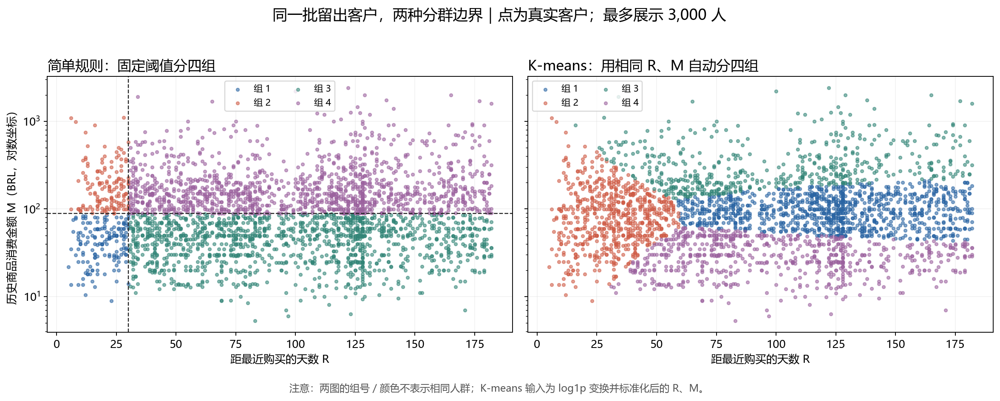

# 已完成的小实验：数字、含义和限制

本页保留最初的小实验结果。后来已完成一次聚类、组内 EDA、候选特征和分类前后对照，见[新增反馈实验与数据清理](09-feedback-and-cleaning.md)。全部结果仍属探索，不是正式确认性测试或真实营销收益。

## 1. 复购分类实验

标签为未来90天是否出现新批准、商品金额为正的订单。测试预测日2018-04-01，标签区间至2018-06-30之前。只预测此前六个月有合格批准订单的已有客户。

| 阶段 | 客户快照数 | 正样本 |
|---|---:|---:|
| 训练 | 21,160 | 211 |
| 验证 | 29,368 | 230 |
| 测试 | 37,813 | 299 |

训练加验证重训时包含重复出现的客户快照；不可把两行不同日期的同一客户当作两个独立自然人。各阶段目标窗口不重叠，ID不进入模型。若需要新客户泛化，还要另外按客户分组留出。

| 方法 | AP | ROC-AUC | Precision@10% | Recall@10% | 前10%名单命中 |
|---|---:|---:|---:|---:|---:|
| 逻辑回归 | 0.0216 | 0.6073 | 1.93% | 24.41% | 73 |
| CatBoost | 0.0212 | 0.6038 | 1.85% | 23.41% | 70 |
| 随机森林 | 0.0226 | 0.6134 | 1.56% | 19.73% | 59 |
| HistGradientBoosting | 0.0144 | 0.5823 | 1.51% | 19.06% | 57 |
| 最近购买优先 | 0.0110 | 0.5732 | 1.19% | 15.05% | 45 |

所有名单均选3,782人。随机选择的期望命中约30人；这是期望参考，不是实际执行营销的结果。

**怎样解释：**有一定排序信息，但精确率仍低。逻辑回归和CatBoost只差3个命中，未计算置信区间，不能断言显著优劣。随机森林总体AP较高，但前10%名单不如逻辑回归；“最好”取决于用途与评价指标。

### 模型设置

按验证集AP选设置。CatBoost测试深度4/6未加权和深度4加权；最终选深度6、48棵树。逻辑回归C=1，比较未加权与balanced，选择未加权。随机森林200棵树、深度8、叶节点最少20个样本，选择未加权。HistGradientBoosting迭代150次、学习率0.05、L2=5，比较15/31叶节点，选择15。

这些仅是有限搜索，不能据此说某算法本质上较差。后续研究不能根据这一测试表反复微调，再声称同一测试期是独立验证。

### 结果文件

- [四模型比较 CSV](../results/classification/model-comparison.csv)
- [完整比较与验证设置](../results/classification/model-comparison.json)
- [CatBoost 原始小实验记录](../results/classification/results.json)

## 2. 客户分群实验

该实验与分类实验的客户资格不同：分群先使用2017-10至2018-03下单、在2018-04-01前已送达且金额为正的订单。共有33,299买家，23,309开发、9,990留出。不能拿这份样本的重复购买比例替代分类实验未来90天复购率。

| 方法 | 同一R/M空间轮廓系数 | 5次抽样平均ARI | 最小群人数 |
|---|---:|---:|---:|
| R/M简单规则 | 0.298 | 0.987 | 458 |
| R/M K-means | 0.331 | 0.873 | 1,813 |
| RFM K-means | 0.330 | 0.997 | 202 |

轮廓系数在同一批2,000名留出客户的相同R/M空间评价；不是把不同空间的分数直接混比。RFM模型在自身三维空间的轮廓系数另为0.384，但不能与二维数字当作公平胜负依据。

每次抽开发样本的80%，重新拟合，再给固定留出客户分群。RFM聚类把留出中的202名多次购买客户单独分成一群。随后补做一个先分出F>1的简单规则，也能找到同一批202人。**这个补充是在看过结果后提出，只是诊断，不是独立确认实验。**

图左边是固定阈值，右边是聚类；颜色编号不能跨图视为同一类人。分得更均匀不自动更好。

### 品类画像示例

留出整体中7.66%的客户买过电脑及配件；R/M聚类的一个较近期群中251/2,140=11.73%，Category lift约1.53。简单规则的近期高消费群对应10.26%、lift约1.34。但群体大小不同，不能只比较最大的lift就认定某方法胜出。

多次购买客户更容易覆盖不同品类，品类缺失也影响估计。正式分析需固定品类选择、报告支持人数并检查稳定性。

- [分群完整记录](../results/segmentation/results.json)
- [分群指标表](../results/segmentation/comparison.csv)

## 3. 现在可以与不可以说什么

可以说：小实验发现有限预测信号，不同算法及分群方式有不同取舍，因此值得系统检验。

不可以说：模型已适用于当前Olist业务；聚类已提升预测；73人是新增复购；客户画像已证明某种营销有效；一个季度的最好成绩就是最终最好模型。

当前没有多期验证、置信区间、真实成本、干预记录或完整平台购买日志。新增实验中的群标记验证 AP 有所提高，但已使用过的测试期 AP 和前 10% 命中均下降；不能把验证期改善包装成稳定效果。
