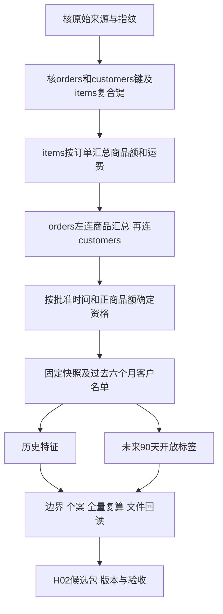

# 我的 IS6400 学习与 1 号工作记录

更新：2026-11-08。作者角色：1号，数据与样本。本文记录实际完成的工作和仍待确认的事项，不代表团队已经验收或课程已提交。

我最初想把 Week 10 的 time_series 教学运用到项目；后来发现，先理解数据、任务与评价时点，比先选择模型更重要。目前主线是根据历史交易信息构建客户快照，支持有限名额的复购候选名单，尚未在这轮工作中完成深度学习或时间序列模型实验。

## 两条阅读路线

| 想了解什么 | 从这里开始 |
|---|---|
| 我怎样从只会运行代码，走到理解数据处理 | [个人学习路径](learning-path.md) |
| 我作为1号收到什么、做什么、交什么 | [1号岗位实施与验收](role-01-data.md) |
| 已经实际跑出了什么、有何限制 | [H02结果与证据](results-and-evidence.md) |
| 队友现在需要做什么 | [交接状态与下一步](handoff-and-next.md) |

## 当前状态

| 工作 | 状态 | 依据 |
|---|---|---|
| 核键、汇总订单金额、连接客户 | 已执行并核查 | [处理阶段汇总](evidence/join-stages.csv) |
| 三期客户特征及开放标签 | 已执行，候选性质 | [覆盖与人数](evidence/coverage-and-cohorts.csv) |
| 全量特征及标签独立复算 | 已通过 | [逐列复算检查](evidence/independent-checks.csv) |
| H02候选v2组内发送 | 本人已反馈发送，6号回复收到 | 仍待收方核对范围与验收结论 |
| 正式时间设计及最终评价 | 待1、3、6号共同核定 | 4月已探索；未生成新的最终评价标签 |
| Slides、英文讲稿、报告要点 | 后续任务 | 应使用核定后的版本与数字 |

## 数据如何变成可交接的输入

公开区只放学习说明、方法与汇总检查。逐行客户表、标签、真实客户追溯附件、微信截图和组内交接ZIP不在这里发布。详细执行Notebook及复跑入口随组内私有H02包交付。

基础项目材料来自 [团队上游仓库](https://github.com/CercaTrovato/olist-repurchase-analysis)。本目录是个人学习及1号实施记录；旧模型结果仍留在仓库原有文档，不能自动当成本轮H02的新建模结果。
